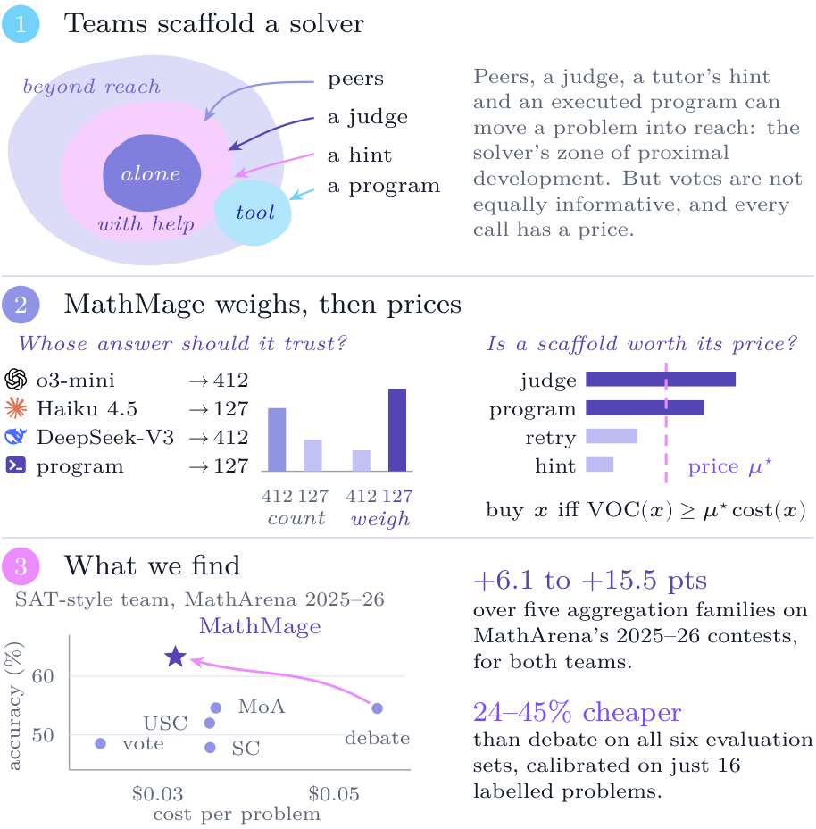
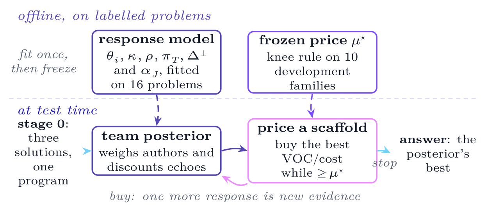
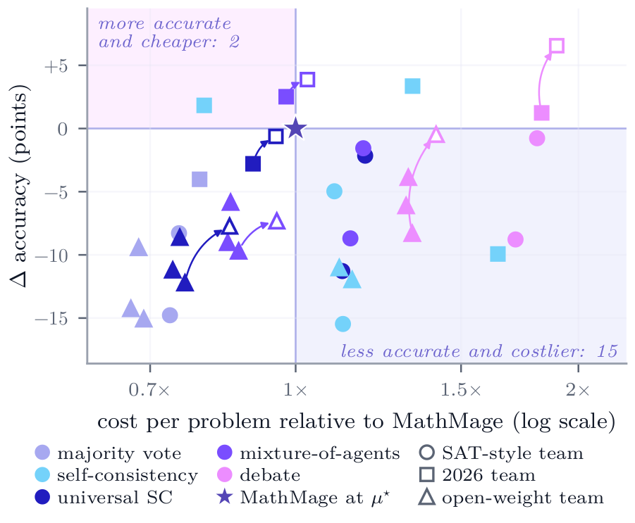
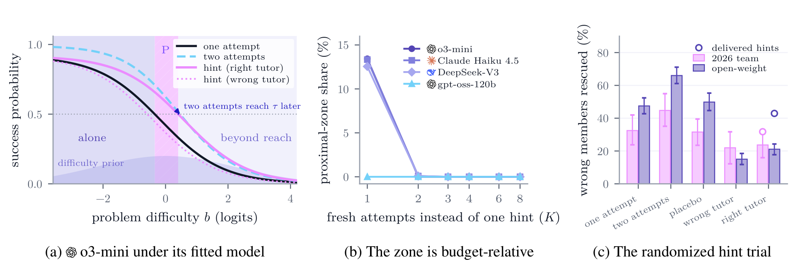

<div align="center">

# MathMage

### Weighing Peers and Pricing Scaffolds for<br>Mathematical Reasoning in Multi-Agent Systems


<a href="#teams-and-evaluation"></a>
<a href="#teams-and-evaluation"></a>
<a href="#results-at-a-glance"></a>
<a href="LICENSE"></a>

**Whose answer should a team trust, and when is another attempt worth its cost?**

</div>

This repository contains the code, frozen benchmark registries, aggregate results and source provenance for the accompanying paper, titled “MathMage: Weighing Peers and Pricing Scaffolds for Mathematical Reasoning in Multi-Agent Systems.” The preprint is coming soon.

## Overview

Multi-agent systems for mathematical reasoning borrow the classroom's whole repertoire: peers propose and critique, a judge adjudicates and a tutor offers hints. They then count every vote as equal and spend the same help on every problem, although two samples from one model often repeat one mistake and an easy problem needs no help at all.

MathMage treats a team of language models as **scaffolding** for a solver, in the sense of Vygotsky's zone of proximal development (ZPD). A Bayesian team posterior, built on scaffolded item response theory and calibrated once on **sixteen labelled problems**, weighs each answer by its author's estimated reliability and discounts echoes of correlated authors; optimal weighted voting is its special case. A value-of-computation controller then buys a fresh attempt, an executed program, a judge's verdict or a hint only while its predicted gain per dollar clears a frozen price. At test time, no gold answer is read.

<p align="center">
  <a href="assets/figures/teaser.png">
    
  </a>
  <br>
  <sub><strong>MathMage in one picture.</strong> (1) Peers, a judge, an executed program and a tutor's hint can move a problem into a solver's zone of proximal development. (2) MathMage weighs answers by their authors' estimated reliability rather than counting votes, and buys a scaffold only while its value of computation per dollar clears a frozen price μ* (schematic). (3) On the MathArena 2025–26 contests it leads five aggregation families on both teams (scatter: SAT-style team), and on all six evaluation sets it costs 24–45% less than debate. From the paper.</sub>
</p>

## Contents

- [Key findings](#key-findings)
- [How MathMage works](#how-mathmage-works)
- [Teams and evaluation](#teams-and-evaluation)
- [Results at a glance](#results-at-a-glance)
- [Repository guide](#repository-guide)
- [Using this repository](#using-this-repository)
- [Scope and interpretation](#scope-and-interpretation)
- [Authors](#authors)
- [Citation](#citation)
- [License](#license)

## Key findings

| Finding | Evidence from the paper |
|:---|:---|
| **Weighing beats counting.** | MathMage leads majority voting on all six evaluation sets, by **4.0–15.1** points. On the MathArena 2025–26 contests it leads all five aggregation families on both teams by **6.1–15.5** points; eight of nine prespecified comparisons pass Holm. Weighting voters by their fitted reliability costs nothing and is the largest single step from the vote to MathMage on five sets and level on the sixth (**2.1–8.8** points). |
| **Pricing scaffolds saves computation.** | MathMage is the most accurate method on five of six evaluation sets and costs **24–45%** less than debate on all six, at **1.3–1.5×** the cost of majority voting. |
| **The leads replicate on fresh problems.** | Under a plan frozen before its first call, MathMage reran unchanged on **187** contest problems released after every member's reported cutoff. On the open-weight team it leads all five baselines by **8.3–15.1** points, each passing Holm. On the 2026 team, whose GPT-5-mini outscores its teammates by 20–29 points, it beats self-consistency (+9.9 points, Holm *p* = 0.015) and ties the other four at 55% of debate's cost. |
| **The team's most capable other is often its program.** | On MathArena problems that split all three SAT-style members, each member is right 11% of the time, but the executed program, when it answers, is right on **56%** (**73%** on the open-weight team); the calibrated posterior ranks the program first on both teams. Shown the same program, debate draws level on the open-weight fresh set at **1.4×** MathMage's cost and leads on the 2026 team by 6.6 points (Holm *p* < 0.001) at **1.9×**. |
| **A correct tutor's hint rescues fewer solvers than a retry.** | In a randomized trial on the open-weight team, one fresh attempt rescued **47.5%** of initially wrong members that had a right tutor, the better of two attempts **66.0%**, and the right tutor's hint only **21.1%** (paired difference −26.4 points, 95% interval [−30.7, −22.5]). The leakage screen blocked half of the right tutors' hints, and delivered hints still trail a retry. The 2026 team shows the same ordering. |

Accuracy is macro accuracy (benchmarks weighted equally), with a bootstrap that resamples near-duplicate problem families, crossed with seeds; cost is the provider-billed price per problem. From the second wave on, sample sizes, baselines, contrasts and Holm families were fixed in timestamped plans before any new call. The evaluation covers 23,952 graded method–problem–seed units on 677 test problems, plus 1,766 mechanism states, for $122.11 in total.

## How MathMage works

<p align="center">
  <a href="assets/figures/flow.png">
    
  </a>
  <br>
  <sub><strong>What is fitted and what is inferred.</strong> The response model is fitted offline, once per team, and the price μ* is frozen on development families. At test time, where no gold answer is read, the posterior weighs the answers and the controller buys scaffolds while their value of computation per dollar clears μ*. From the paper.</sub>
</p>

1. **Calibrate once.** Fit each author's ability, the spread of difficulty, response dependence, wrong-answer collisions and scaffold effects on 16 labelled training problems. Choose the price μ* on 10 development families by a knee rule: the cheapest operating point within one percentage point of the best development accuracy. Freeze both.
2. **Collect independent proposals.** Each member solves the problem alone, and one member writes a program whose executed answer is independent evidence; certificate checks add more.
3. **Weigh the evidence.** Infer a posterior over the candidate answers and the problem's difficulty that discounts correlated authors and coincident wrong answers. A reliability-weighted vote is its special case.
4. **Price the next scaffold.** Predict each affordable action's value of computation per dollar: a fresh attempt, an alternative program, a diversified solution, a review and rebuttal, a judge's verdict, or a hint in one of four formats (strategic, decomposition, Socratic, diagnosis). Buy the best while it clears μ*.
5. **Commit, then grade.** Return the posterior's best answer without reading a label. A separate grader reads the answer vault afterwards.

A single maximal run (μ = 0) records every purchase in order, so one trace replays every price threshold.

## Teams and evaluation

| Team | Members | Implementation |
|:---|:---|:---|
| **SAT-style** | o3-mini at low reasoning effort, Claude Haiku 4.5, and DeepSeek-V3, which also writes the program | [`mathmage/`](mathmage/), [`configs/`](configs/) |
| **Open-weight** | Three independent instances of gpt-oss-120b at low reasoning effort, one of which writes the program | [`lanes/open_weight/`](lanes/open_weight/) |
| **2026** | The SAT-style team with GPT-5-mini at low reasoning effort in place of o3-mini, which OpenAI retired before the fourth wave; recalibrated on the same training problems | [`lanes/sat26/`](lanes/sat26/) |

The evaluation ran in four waves and a parity follow-up. **E1** (SAT-style team, 237 problems) adapts SAT's collection: AIME 2024–2026, HMMT February 2026 and 114 TheoremQA physics problems. **E2** (open-weight team, 580 evaluations) is AIME 2024 and 2025 over eight seeds plus 100 MATH-500 problems. The **MathArena 2025–26 contests** add HMMT November 2025, BRUMO, CMIMC and SMT 2025 to MathArena's 2025–26 AIME and HMMT February sets. The **fresh set** holds 187 problems from five contests held between November 2025 and April 2026 (HMMT, PUMaC, CMIMC, BrUMO), after every member's reported cutoff.

The baselines are majority voting, self-consistency, universal self-consistency, one round of debate and mixture-of-agents. All but self-consistency reuse the members' stage-0 solutions; self-consistency draws its own samples at about matched cost. Every judge-based method, MathMage included, shares one frozen judge, so differences come from aggregation alone. The parity follow-up shows universal self-consistency, mixture-of-agents and debate MathMage's executed program.

## Results at a glance

Macro accuracy (%) of every aggregation family on the same member stage-0 solutions. **Bold** marks each column's most accurate method; <sup>∗</sup> marks a baseline that MathMage at μ* beats under its stated rule.

| Method | SAT-style<br>Original suite<br><sub>n = 237</sub> | SAT-style<br>MathArena 2025–26<br><sub>n = 216</sub> | 2026 team<br>Fresh set<br><sub>n = 187</sub> | Open-weight<br>Original suite<br><sub>n = 580</sub> | Open-weight<br>MathArena 2025–26<br><sub>n = 1,968</sub> | Open-weight<br>Fresh set<br><sub>n = 1,496</sub> |
|:---|:---:|:---:|:---:|:---:|:---:|:---:|
| Best single model | 47.7 | 45.4 | 65.7 | 68.2 | 51.2 | 56.1 |
| Majority vote | 52.8<sup>∗</sup> | 48.5<sup>∗</sup> | 65.4 | 72.6<sup>∗</sup> | 55.8<sup>∗</sup> | 60.8<sup>∗</sup> |
| Self-consistency | 56.1 | 47.8<sup>∗</sup> | 59.5<sup>∗</sup> | –<sup>†</sup> | 59.1<sup>∗</sup> | 63.9<sup>∗</sup> |
| Universal self-consistency | 58.9 | 52.0<sup>∗</sup> | 66.6 | 73.4<sup>∗</sup> | 58.9<sup>∗</sup> | 63.7<sup>∗</sup> |
| Debate | 60.3 | 54.5<sup>∗</sup> | 70.7 | 78.1 | 64.0<sup>∗</sup> | 67.6<sup>∗</sup> |
| Mixture-of-agents | 59.5 | 54.6<sup>∗</sup> | 71.9 | 76.1<sup>∗</sup> | 61.1<sup>∗</sup> | 66.2<sup>∗</sup> |
| **MathMage (μ\*)** | **61.0** | **63.3** | 69.4 | 82.0 | 70.1 | 75.9 |
| MathMage (μ = 0) | 59.1 | 61.2 | **72.9** | **83.7** | **72.7** | **77.1** |

*Stated rule*: Holm within the prespecified families, the recorded 0.0294 threshold for pooled debate, otherwise a 95% interval excluding zero. Bootstrap standard errors are 2.4–3.8 points. μ = 0 is MathMage's maximal run; n counts problem–seed units. The 2026 team's self-consistency is DeepSeek-V3 SC@10; self-consistency of GPT-5-mini alone (SC@5) reaches 72.8%. <sup>†</sup>Run on E2's AIME problems only, where MathMage's maximal run leads by 15.1 points (Holm *p* < 0.001).

<p align="center">
  <a href="assets/figures/frontier.png">
    
  </a>
  <br>
  <sub><strong>Accuracy and cost together.</strong> Every baseline on every evaluation set relative to MathMage at μ*: the difference in accuracy against cost per problem as a multiple of MathMage's (log scale). Hollow markers give the interactive baselines MathMage's executed program (arrows from the originals); only debate shown the program, on the 2026 team, is significantly ahead. From the paper.</sub>
</p>

<p align="center">
  <a href="assets/figures/zpd.png">
    
  </a>
  <br>
  <sub><strong>The zone of proximal development of a language-model team.</strong> (a) o3-mini under its fitted model: hatched, the proximal zone against one retry; two retries reach τ = ½ at a harder difficulty than a right tutor's hint. (b) The proximal share against the number K of retries offered instead of one hint: about 13% for SAT-style members at K = 1, at most 0.1% at K = 2. (c) The randomized hint trial: initially wrong members with a right tutor rescued by each arm (95% intervals; hollow: delivered hints only). From the paper.</sub>
</p>

## Repository guide

| Path | Contents |
|:---|:---|
| [`mathmage/`](mathmage/) | Posterior, policy, team engine, prompts, calibration, grading, provider client and sandboxed tools: the SAT-style team's package |
| [`configs/`](configs/) | Model, routing and spending configuration for the root package |
| [`lanes/open_weight/`](lanes/open_weight/) | The open-weight team's package and configuration, its launcher, its effort-selection protocol and the training-only pilot that applied it |
| [`lanes/sat26/`](lanes/sat26/) | The 2026 team's package and configuration |
| [`scripts/`](scripts/) | Registry builders, mock and live entry points, wave drivers, the grading guard and the provenance check |
| [`analysis/`](analysis/) | The paper's estimators, contrasts, robustness checks and figure code |
| [`data/registry/`](data/registry/) | Original problems, family and split assignments, named subsets, data card and the separate answer vault |
| [`data/registry_ext/`](data/registry_ext/) | Further MathArena 2025–26 contest problems and their provenance |
| [`data/registry_v6/`](data/registry_v6/) | The fresh set: problems, source transcriptions, curation decisions and hash manifest |
| [`results/tables/`](results/tables/) | Aggregate JSON summaries behind the paper's tables and figures |
| [`results/provenance.json`](results/provenance.json) | Source hashes that the frozen plans and manifests recorded before their calls |
| [`tests/`](tests/) | Tests of inference, calibration, policy, grading, label isolation, execution and accounting |
| [`docs/reproducibility.md`](docs/reproducibility.md) | Code map, data provenance, recorded-run requirements and release edits |

### Experiment map

| Stage | Entry points |
|:---|:---|
| Pilots and calibration | `scripts/pilot.py`, `scripts/offline_phase.py`, `lanes/open_weight/pilot_effort.py` |
| First wave: original suites, ablations and ZPD continuations | `scripts/run_paid_program.py` (SAT-style), `lanes/open_weight/run_lane.py` (open-weight); single-study runners `scripts/run_e1_sat.py`, `run_ablations.py`, `run_zpd.py` |
| Second and third waves: MathArena 2025–26 contests and the baseline matrix | `scripts/v4_followup.py`, `scripts/v5_followup.py` |
| Fourth wave: fresh set, mechanism layer, hint trial and refitting | `scripts/v6_followup.py`, `scripts/v6_fit.py`, `scripts/v6_guarded.py` |
| Parity follow-up | `scripts/v7_parity.py` |

The `v4`–`v7` script names are the identifiers under which the saved plans record the second, third and fourth waves and the parity follow-up; later drivers import earlier ones. `scripts/run_e2_xolver.py` keeps the name of the original E2 interface, built for a Qwen3-32B roster; the paper's open-weight team replaced that roster, as `lanes/open_weight/PROTOCOL.md` records.

## Using this repository

### Install and check

Use Python **3.11 or newer**. From the repository root:

```bash
python -m venv .venv
source .venv/bin/activate          # Windows PowerShell: .\.venv\Scripts\Activate.ps1
python -m pip install -e '.[dev]'
python -m pytest
```

### Verify the frozen sources

```bash
python scripts/verify_provenance.py
```

Before its first model call, every plan and manifest of the study recorded SHA-256 hashes of what it would run. This command recomputes the 26 recorded bindings that this release can reproduce: the protocol digests of the three team packages, the drivers, the model configurations and the registries. It should report `26 of 26 recorded bindings reproduced`: the frozen code, configurations and data here are byte for byte those that the recorded runs bound. The [reproducibility guide](docs/reproducibility.md#source-provenance-and-release-edits) lists the few files that differ from the development tree.

### Run a small mock study

```bash
python scripts/pilot.py --limit 3
python scripts/offline_phase.py --train-limit 2 --dev-limit 2 --no-public-logs
python scripts/run_e1_sat.py --limit 3 --artifacts runs/offline_sat_mock/artifacts.json
python scripts/run_ablations.py --limit 2 --artifacts runs/offline_sat_mock/artifacts.json
```

These commands default to **mock mode**, need no API key or network access, and write synthetic responses under `runs/`. They exercise collection, calibration, evaluation and the ablations; their scores are not the paper's results. `--no-public-logs` skips the optional download of public MathArena responses, and mock artifacts are marked synthetic, so they cannot authorize a live run.

### Inspect or reproduce the analyses

The aggregate summaries in [`results/tables/`](results/tables/) can be read directly. Three figures redraw from them without any model call:

```bash
python analysis/fig_frontier.py --draft
python analysis/fig_cost.py --draft
python analysis/fig_v6.py --draft
```

**Raw live runs are not bundled.** Recomputing the paper's statistics needs the recorded agent outputs, graded records, frozen calibration artifacts and manifests; the follow-up drivers, including their `mocktest` modes, need them as well. The [reproducibility guide](docs/reproducibility.md) gives the expected layout. A new live study reads `OPENROUTER_API_KEY`, prices an itemized plan with `--live --estimate`, and runs only with that plan's `--approved-plan` identifier, under a budget ledger.

## Scope and interpretation

- **Inference is label-free; calibration is supervised.** Reference answers and source solutions are kept apart from the problem views sent to agents. Training labels estimate the parameters, and development labels choose the operating point.
- **Probabilities depend on the fitted model.** Posterior confidence and zone assignments are model-based estimates; they do not observe a model's developmental zone directly, nor do they establish held-out calibration by themselves.
- **Execution supplies evidence, not proof.** A program that returns an answer need not model the problem faithfully, and certificate checks and reviews are fallible evidence.
- **Hint screening has limits.** Structural screens reject obvious answer leakage; they do not establish semantic non-leakage or that a hint leaves meaningful work for its recipient.
- **Tool availability changes the experiment.** Generated Python runs in an isolated Docker backend or an explicitly selected local-process backend, which offers only limited isolation. Live tool-enabled methods need their selected runtime and matching calibration artifacts.
- **A post-cutoff date lowers one contamination risk.** Release after a model's reported cutoff does not certify that the problems were unseen.
- **The recorded settings are historical.** Model identifiers, provider routing, token limits and prices describe the study as run. OpenAI has retired o3-mini, so the SAT-style team cannot be rerun as recorded; the 2026 team is its replacement.

See the paper's limitations section for the full account.

## Authors

Withheld for anonymity.

## Citation

Citation details will be added once the paper is de-anonymized.

## License

The code is released under the [MIT License](LICENSE). Benchmark problems, solutions and source materials keep their original licenses and attribution requirements; their provenance is recorded with the registries (see the [reproducibility guide](docs/reproducibility.md#data-and-provenance)).
